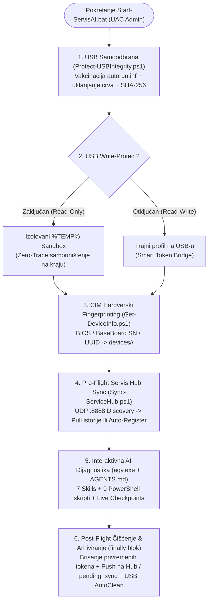

# 🛠️ AGY Serviser Portable — Prenosivi AI Asistent za Servisnu Dijagnostiku


**AGY Serviser Portable** je specijalizovani prenosivi (*Zero-Install*) USB dijagnostički sistem namenjen računarskim serviserima i inženjerima terenske podrške za brzu, dubinsku i bezbednu hardversku i softversku dijagnostiku na operativnim sistemima **Windows 10 i Windows 11**.

Sistem pokreće zvanični **Antigravity CLI (`agy.exe`)** uparen sa nativnim PowerShell dijagnostičkim modulima i **Google AI Pro** pretplatom — omogućavajući **Root-Cause** analizu kvarova bez instalacije dodatnog softvera na računar klijenta, bez dodatnih API troškova po tokenu i bez izlaganja vaših lozinki potencijalno zaraženim mašinama.

<details>
<summary>🌐 <b>English Summary (Click to expand)</b></summary>

### What is AGY Serviser Portable?
**AGY Serviser Portable** is a zero-install, portable USB AI diagnostics framework built for PC repair workshops and field technicians running on **Windows 10 and Windows 11**. It combines the standalone Go binary **Antigravity CLI (`agy.exe`)** with 9 native PowerShell diagnostic scripts and 7 specialized AI Agent Skills.

#### Key Engineering Highlights:
- 🔒 **Zero-Trust Headless OAuth & Zero-Trace Cleanup:** Emulates a headless SSH environment (`SSH_CLIENT`/`SSH_TTY`) so the client PC never opens a browser or sees your Google password. Auth is performed once via smartphone, and temporary token bridges are deterministically wiped on exit (`finally` block).
- 🛡️ **Active USB Self-Defense (`Protect-USBIntegrity.ps1`):** Automatically vaccinates `autorun.inf`, removes malicious `.lnk`/`.vbs`/stray `.exe` worms before and after every session, and verifies SHA-256 integrity (`checksums.json`).
- 🧬 **Hardware Write-Protect & CIM Device Fingerprinting (`Get-DeviceInfo.ps1`):** Detects read-only hardware switches (falling back to an isolated `%TEMP%` sandbox) and identifies each machine by BIOS/BaseBoard serial number or SMBIOS UUID, maintaining isolated per-device workspaces (`devices/<DeviceTag>/`).
- 🔄 **Bidirectional Workshop Hub Sync (ADR-0003 & ADR-0004):** Discovers the workshop's central **Servis Hub** server via UDP broadcast (`:8888`), pulls prior repair history before diagnosis, streams live in-flight checkpoints (`Save-ServiceProgress.ps1`), and queues sessions offline (`pending_sync/`) when working in the field.

</details>

---

## 🖥️ Prikaz Rada u Terminalu (Terminal Preview)

```text
==================================================================
         ANTIGRAVITY CLI PORTABLE - SERVISNI ASISTENT             
           Google AI Pro Tehnologija za Servisnu Dijagnostiku     
==================================================================

[*] Pokrecem USB samozastitu i proveru integriteta medijuma...
  [OK] USB je vec imunizovan (zasticen autorun.inf folder).
  [OK] Nisu pronadjeni poznati obrasci USB crva i precica.
  [OK] Integritet svih kljucnih fajlova je sacuvan (SHA-256 OK).

[*] Provera internet veze sa servisima... [OK]
[*] Aktivna trajna sesija sa USB medijuma: E:\ServisAI\data\accounts\primary
[*] Ocitavanje hardvera i serijskog broja klijentskog racunara...
------------------------------------------------------------------
IDENTIFIKOVAN KLIJENTSKI RACUNAR:
  - Uredjaj:       LENOVO ThinkPad T14 Gen 2
  - Serijski broj: PF2A1234
  - Hardver:       AMD Ryzen 7 PRO 5850U | 16.0 GB RAM
  - Karton:        E:\ServisAI\devices\LENOVO_ThinkPad_T14_PF2A1234
------------------------------------------------------------------
[*] Provera servisne istorije na centralnom Servis Hub-u...
  [OK] Generisan servisni kontekst: devices\LENOVO_ThinkPad_T14_PF2A1234\SERVIS_HUB_HISTORY.md
  [OK] Servisna istorija uspesno ucitana u radni prostor agenta.
------------------------------------------------------------------
[*] Pokrecem Antigravity CLI sesiju... (za izlaz unesite /exit ili Ctrl+D)

Serviser > Racunar se nasumicno gasi pod opterecenjem. Proveri diskove, WHEA greske i minidumpove.
```

---

## ⚡ Zašto AGY Serviser? (Arhitektonske Prednosti)

| Izazov u servisu | Tradicionalni pristup | AGY Serviser Portable rešenje |
| :--- | :--- | :--- |
| **Instalacija na klijentu** | Instalacija više alata, biblioteka ili Python/Node okruženja | **Nula instalacija (Zero-Install)** — izvršava se direktno sa USB-a koristeći ugrađeni PowerShell 5.1 i `agy.exe` |
| **Bezbednost naloga** | Kucanje Google lozinke u browseru potencijalno zaraženog PC-ja | **Zero-Trust Headless OAuth** preko telefona + **Zero-Trace** brisanje privremenog mosta tokena pri izlazu |
| **Zaraženi klijentski PC** | USB fleš biva zaražen `.lnk` crvima i malicioznim skriptama | **Pre-flight & Post-flight samoodbrana** — vakcinacija `autorun.inf`, auto-čišćenje i SHA-256 provera integriteta |
| **Fizički zaključan USB** | Aplikacije pucaju jer ne mogu da upišu keš na Read-Only fleš | **HW Write-Protect detekcija** — automatsko preusmeravanje profila u izolovani `%TEMP%` sandbox klijenta |
| **Izolovanost servisa** | Beleške ostaju na jednom flešu ili na papirnim reversima | **Dvosmerni Servis Hub Sync (ADR-0003/0004)** — UDP Auto-Discovery (`:8888`), Live Checkpoints i offline red čekanja |

---

## 🏛️ Arhitektura i Životni Ciklus Dijagnostičke Sesije



---

## 🧰 Katalog Servisnih Veština (Skills) i PowerShell Alata

AI agent autonomno koristi **7 specijalizovanih servisnih veština** (`.agents/skills/`) i **9 nativnih PowerShell skripti** (`scripts/`):

| Veština (Skill) | PowerShell Skripta | Namena u dijagnostici |
| :--- | :--- | :--- |
| `/device-audit` | [`scripts/Get-DeviceInfo.ps1`](scripts/Get-DeviceInfo.ps1) | Očitavanje BIOS/ploča serijskog broja, UUID-a, CPU, RAM, GPU, diskova i kreiranje `DEVICE_INFO.md` kartona. |
| `/smart-health` | [`scripts/Get-DiskHealth.ps1`](scripts/Get-DiskHealth.ps1) | Dubinska SMART i NVMe telemetrija: procenat istrošenosti (wear), loši sektori, temperature i greške čitanja/upisa. |
| `/event-log-triage` | [`scripts/Get-EventLogTriage.ps1`](scripts/Get-EventLogTriage.ps1) | Filtriranje kritičnih padova u System/Application dnevnicima (`Kernel-Power 41`, `WHEA-Logger`, disk i drajver tajmauti). |
| `/bsod-analyzer` | [`scripts/Get-MinidumpReport.ps1`](scripts/Get-MinidumpReport.ps1) | Analiza `C:\Windows\Minidump` datoteka, BugCheck (`Stop`) kodova i identifikacija drajvera koji ruše kernel. |
| `/system-integrity` | [`scripts/Test-SystemIntegrity.ps1`](scripts/Test-SystemIntegrity.ps1) | Bezbedna ne-destruktivna provera integriteta sistemskih fajlova (`SFC /scannow` i `DISM /CheckHealth`). |
| `/malware-triage` | [`scripts/Find-SuspiciousAutoruns.ps1`](scripts/Find-SuspiciousAutoruns.ps1) | Detekcija sumnjivih autorun ključeva, zakazanih zadataka i procesa pokrenutih iz `Temp`/`AppData` direktorijuma. |
| `/usb-defense` | [`scripts/Protect-USBIntegrity.ps1`](scripts/Protect-USBIntegrity.ps1) | Vakcinacija `autorun.inf` foldera, eliminacija `.lnk`/`.vbs` crva i SHA-256 verifikacija integriteta alata. |
| *(Automatski / In-Flight)* | [`scripts/Save-ServiceProgress.ps1`](scripts/Save-ServiceProgress.ps1) | Snimanje operativnih nalaza u hodu (*Live Checkpoint*) u `SERVISNI_DNEVNIK.md` i ažuriranje statusa na Servis Hub-u. |
| *(Pre/Post-Flight Sync)* | [`scripts/Sync-ServiceHub.ps1`](scripts/Sync-ServiceHub.ps1) | UDP Auto-Discovery (`:8888`), Pre-flight Pull istorije, Post-flight Push izveštaja i upravljanje `pending_sync/` redom. |

---

## 📂 Struktura Projekta

```text
USB:\ServisAI\
├── Start-ServisAI.bat            # Brzi dvoklik pokretač (UAC elevacija i priprema okruženja)
├── Start-ServisAI.ps1            # Glavni orkestrator (USB zaštita, profil, CIM karton, Hub sync)
├── AGENTS.md                     # Sistemski prompt: Root-Cause metodologija i Non-Destructive pravila
├── TEHNICKA_DOKUMENTACIJA.md     # Inženjerski referentni priručnik sistema (10 poglavlja)
├── UPUTSTVO_ZA_KORISCENJE.md     # Praktični vodič za rad servisera na terenu
├── config\
│   └── settings.json             # Konfiguracija modela (gemini-2.5-pro) i Servis Hub parametara
├── bin\
│   ├── agy.exe                   # Zvanični Antigravity CLI za Windows x64 (preuzima se lokalno)
│   └── README_BIN.md             # Uputstvo za preuzimanje i postavljanje agy.exe
├── scripts\                      # 9 samostalnih PowerShell dijagnostičkih i sinhronizacionih skripti
├── .agents\
│   └── skills\                   # 7 specijalizovanih servisnih veština za Antigravity agenta
├── devices\                      # Automatski kreirani kartoni uređaja (ignorisano u Git-u)
├── pending_sync\                 # Offline red čekanja za Servis Hub pakete (ignorisano u Git-u)
├── tests\                        # E2E integracioni testovi protokola sinhronizacije (11 scenarija)
└── wiki\                         # Obsidian baza znanja (Arhitektura, ADR-0001..0004, Rečnik, Gotchas)
```

---

## 🚀 Brzi Start (Priprema za 3 Minuta)

### 1. Priprema USB fleš memorije (jednokratno)
1. Klonirajte ovaj repozitorijum ili ga prekopirajte na USB fleš memoriju (npr. `E:\ServisAI`):
   ```bash
   git clone https://github.com/Gruya13/agy-serviser-portable.git E:\ServisAI
   ```
2. Preuzmite zvanični `agy.exe` za Windows x64 i smestite ga u `bin\agy.exe` (detalji u [`bin/README_BIN.md`](bin/README_BIN.md)):
   ```powershell
   irm https://antigravity.google/cli/install.ps1 | iex
   Copy-Item "$env:LOCALAPPDATA\agy\bin\agy.exe" -Destination "E:\ServisAI\bin\agy.exe"
   ```

### 2. Jednokratna autorizacija preko telefona (u vašoj radionici)
1. Pokrenite **`Start-ServisAI.bat`** na svom radnom računaru.
2. Otvorite prikazani OAuth link **na svom pametnom telefonu** (gde ste prijavljeni na Google AI Pro nalog) i unesite kratki verifikacioni kod u terminal.
3. Unesite `/exit`. Vaš token je sada bezbedno sačuvan na USB-u (`data/`) i na klijentskim računarima **nećete morati ponovo da se prijavljujete**.

### 3. Dijagnostika na računaru klijenta
1. Ubacite USB u računar klijenta (Windows 10/11) i pokrenite **`Start-ServisAI.bat`**.
2. Sistem će automatski proveriti integritet USB-a, očitati serijski broj računara, kreirati njegov servisni karton i učitati prethodnu istoriju sa Servis Hub-a.
3. Postavite zadatak asistentu na srpskom jeziku (npr. *"Proveri zdravlje diskova, analiziraj poslednje BSOD padove i snimi izveštaj"*).
4. Po završetku rada unesite `/exit` — skripta automatski briše sve privremene tragove sa klijentskog računara, šalje izveštaj na Servis Hub i čisti USB.

---

## 🧪 Pokretanje Testova

Projekat poseduje kompletan paket od **11 End-to-End (E2E) test scenarija** koji verifikuju parsiranje hardverskih kartona, Pre-flight registraciju, Live Checkpoints, dvosmerni sync i offline red čekanja (`pending_sync/`):

```bash
python3 -m unittest discover -s tests -p "test_*.py" -v
```

---

## 📚 Kompletna Dokumentacija i Baza Znanja

- 📖 **[Tehnička Dokumentacija (`TEHNICKA_DOKUMENTACIJA.md`)](TEHNICKA_DOKUMENTACIJA.md)** — Detaljan inženjerski referentni priručnik (šestoslojna arhitektura, Zero-Trust model, CIM fingerprinting algoritam, ADR-0003/0004 specifikacija i Ops Runbook).
- 🛠️ **[Uputstvo za Korišćenje (`UPUTSTVO_ZA_KORISCENJE.md`)](UPUTSTVO_ZA_KORISCENJE.md)** — Praktični vodič za servisere na terenu sa primerima dijagnostičkih upita i rešavanjem problema.
- 🧠 **[Arhitektonska Baza Znanja (`wiki/index.md`)](wiki/index.md)** — Obsidian Wiki sa arhitektonskim odlukama ([ADR-0001](wiki/decisions/ADR-0001-portable-usb-architecture.md), [ADR-0002](wiki/decisions/ADR-0002-hardware-write-protect-and-device-fingerprint.md), [ADR-0003](wiki/decisions/ADR-0003-servis-hub-bidirectional-sync.md), [ADR-0004](wiki/decisions/ADR-0004-preflight-registration-and-live-checkpoint.md)), [rečnikom domena](wiki/domain/glossary.md) i [baza rešenih zamki (`gotchas.md`)](wiki/memory/gotchas.md).
- 📜 **[Istorija Izrade (`istorija_izrade.md`)](istorija_izrade.md)** — Hronološki dnevnik razvoja i arhitektonskih unapređenja.

---

## 📄 Licenca

Ovaj projekat je objavljen pod [MIT licencom](LICENSE).
