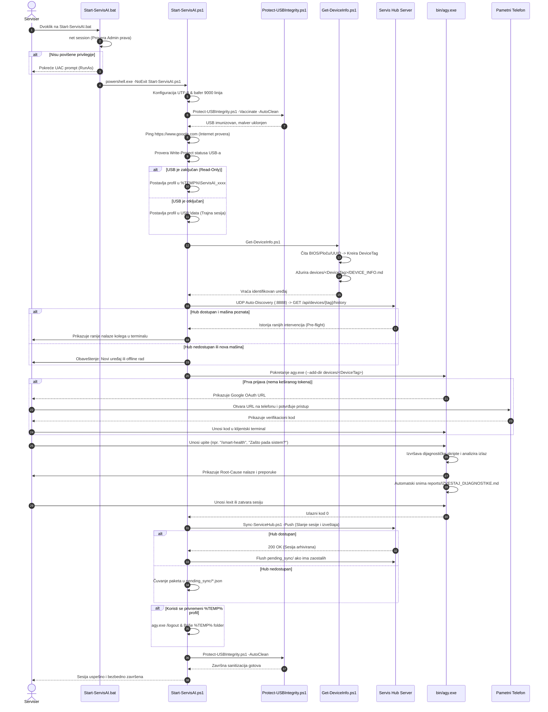
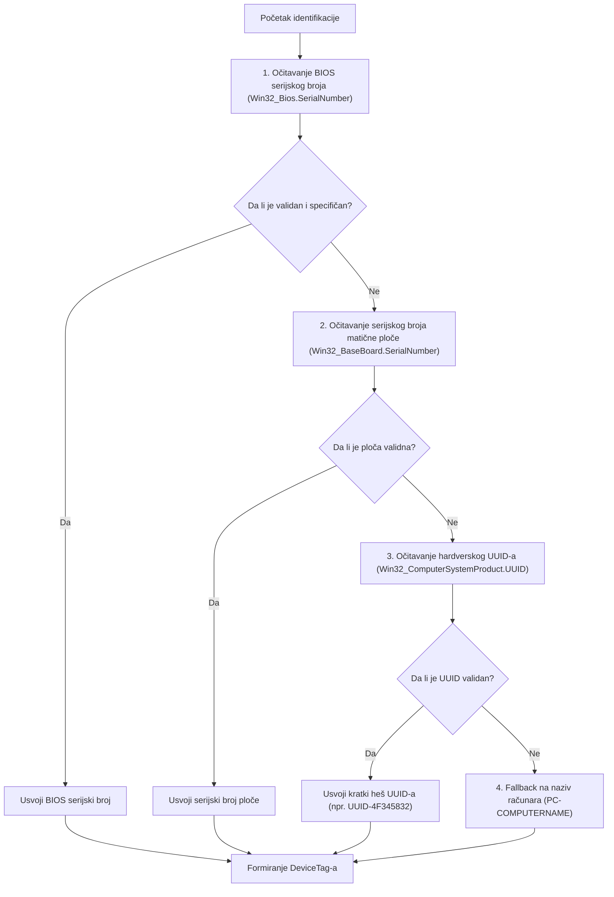
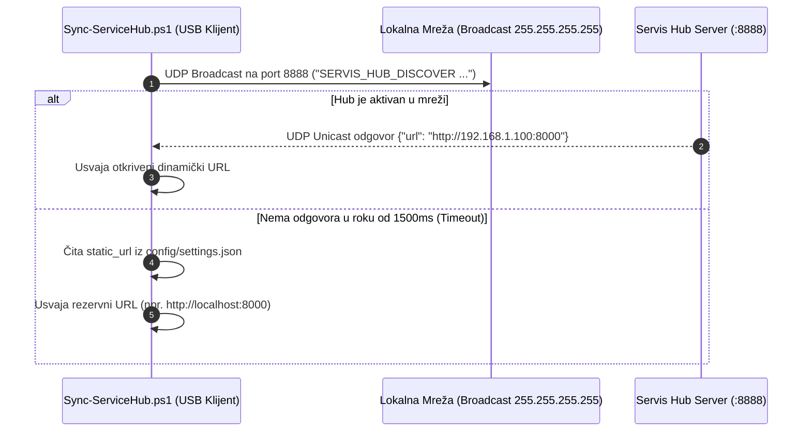

# Tehnička Dokumentacija Sistema - AGY Serviser Portable

**Verzija dokumentacije:** 3.1.0  
**Status:** Produkcija / Prihvaćeno  
**Datum revizije:** Oktobar 2026.  
**Projekat:** AGY Serviser Portable (Antigravity CLI Portable)  
**Autor:** Tehnički tim & Servis AI Arhitekta  

---

## Sadržaj

1. [Uvod i Sistemski Pregled](#1-uvod-i-sistemski-pregled)
   - [1.1 Svrha i Misija Projekta](#11-svrha-i-misija-projekta)
   - [1.2 Poslovni i Tehnički Zahtevi](#12-poslovni-i-tehnički-zahtevi)
   - [1.3 Tehnološki Stek i Preduslovi](#13-tehnološki-stek-i-preduslovi)
   - [1.4 Ključne Arhitektonske Prednosti](#14-ključne-arhitektonske-prednosti)
2. [Arhitektura Sistema i Struktura Slojeva](#2-arhitektura-sistema-i-struktura-slojeva)
   - [2.1 Šestoslojni Arhitektonski Model](#21-šestoslojni-arhitektonski-model)
   - [2.2 Globalni Dijagram Arhitekture (Mermaid)](#22-globalni-dijagram-arhitekture-mermaid)
   - [2.3 Fizička i Logička Struktura USB Medijuma](#23-fizička-i-logička-struktura-usb-medijuma)
   - [2.4 Životni Ciklus Dijagnostičke Sesije](#24-životni-ciklus-dijagnostičke-sesije)
3. [Pokretački i Orkestracioni Podsistem](#3-pokretački-i-orkestracioni-podsistem)
   - [3.1 Bootstrap Sloj: `Start-ServisAI.bat`](#31-bootstrap-sloj-start-servisaibat)
   - [3.2 Glavni Orkestrator: `Start-ServisAI.ps1`](#32-glavni-orkestrator-start-servisaips1)
   - [3.3 Otklanjanje Konzolnih i Bafer Bagova (Conhost Optimization)](#33-otklanjanje-konzolnih-i-bafer-bagova-conhost-optimization)
   - [3.4 Upravljanje Profilima i Višestrukim Nalozima (Multi-Account Profile Management)](#34-upravljanje-profilima-i-višestrukim-nalozima-multi-account-profile-management)
4. [Identifikacija Računara i Digitalni Kartoni (Hardware Fingerprinting)](#4-identifikacija-računara-i-digitalni-kartoni-hardware-fingerprinting)
   - [4.1 Hijerarhija Očitavanja Serijskog Broja](#41-hijerarhija-očitavanja-serijskog-broja)
   - [4.2 Generisanje Oznake Uređaja (`DeviceTag`)](#42-generisanje-oznake-uređaja-devicetag)
   - [4.3 Digitalni Servisni Karton (`DEVICE_INFO.md`)](#43-digitalni-servisni-karton-device_infomd)
   - [4.4 Hronološki Dnevnik Intervencija (`SERVISNI_DNEVNIK.md`)](#44-hronološki-dnevnik-intervencija-servisni_dnevnikmd)
5. [Bezbednosni Model, Zero-Trust i USB Samoodbrana](#5-bezbednosni-model-zero-trust-i-usb-samoodbrana)
   - [5.1 Zero-Trust Pristup i Headless Remote OAuth](#51-zero-trust-pristup-i-headless-remote-oauth)
   - [5.2 Podrška za Hardware Write-Protect (Zaključani USB)](#52-podrška-za-hardware-write-protect-zaključani-usb)
   - [5.3 Mehanizam USB Samoodbrane i Imunizacije (`Protect-USBIntegrity.ps1`)](#53-mehanizam-usb-samoodbrane-i-imunizacije-protect-usbintegrityps1)
   - [5.4 Kontrola Integriteta i Heš Provera (`checksums.json`)](#54-kontrola-integriteta-i-heš-provera-checksumsjson)
   - [5.5 Strogo Ne-Destruktivno Pravilo (Non-Destructive Safety Guardrail)](#55-strogo-ne-destruktivno-pravilo-non-destructive-safety-guardrail)
6. [Dijagnostički Moduli i PowerShell Skripte](#6-dijagnostički-moduli-i-powershell-skripte)
   - [6.1 `Get-DiskHealth.ps1` (SMART i NVMe Telemetrija)](#61-get-diskhealthps1-smart-i-nvme-telemetrija)
   - [6.2 `Get-EventLogTriage.ps1` (Trijaža Kritičnih Sistemskih Logova)](#62-get-eventlogtriageps1-trijaža-kritičnih-sistemskih-logova)
   - [6.3 `Get-MinidumpReport.ps1` (BSOD Analiza i Rušenja Sistema)](#63-get-minidumpreportps1-bsod-analiza-i-rušenja-sistema)
   - [6.4 `Test-SystemIntegrity.ps1` (Kontrola Integriteta Datoteka SFC/DISM)](#64-test-systemintegrityps1-kontrola-integriteta-datoteka-sfcdism)
   - [6.5 `Find-SuspiciousAutoruns.ps1` (Detekcija Perzistencije Malvera)](#65-find-suspiciousautorunsps1-detekcija-perzistencije-malvera)
   - [6.6 `Get-DeviceInfo.ps1` (CIM Očitavanje Hardvera)](#66-get-deviceinfops1-cim-očitavanje-hardvera)
   - [6.7 `Protect-USBIntegrity.ps1` (Imunizacija i Sanitizacija)](#67-protect-usbintegrityps1-imunizacija-i-sanitizacija)
7. [Katalog Servisnih Veština za AI Agenta (Skills System)](#7-katalog-servisnih-veština-za-ai-agenta-skills-system)
   - [7.1 Arhitektura Veština i Učitavanje u `agy`](#71-arhitektura-veština-i-učitavanje-u-agy)
   - [7.2 Specifikacija Pojedinačnih Veština](#72-specifikacija-pojedinačnih-veština)
   - [7.3 Protokol Formatiranja Odgovora i Trajno Snimanje Izveštaja](#73-protokol-formatiranja-odgovora-i-trajno-snimanje-izveštaja)
8. [Integracija sa Centralnim Servis Hub-om (ADR-0003 Specifikacija)](#8-integracija-sa-centralnim-servis-hub-om-adr-0003-specifikacija)
   - [8.1 Arhitektonski Problem Izolovanih Medijuma](#81-arhitektonski-problem-izolovanih-medijuma)
   - [8.2 Mrežna Detekcija: UDP Auto-Discovery (:8888) i Statički Fallback](#82-mrežna-detekcija-udp-auto-discovery-8888-i-statički-fallback)
   - [8.3 Pre-flight Pull Protokol (Očitavanje Istorije)](#83-pre-flight-pull-protokol-očitavanje-istorije)
   - [8.4 Post-flight Push Protokol (Arhiviranje Sesije)](#84-post-flight-push-protokol-arhiviranje-sesije)
   - [8.5 Offline Red Čekanja (`pending_sync/`) i Auto-Flush](#85-offline-red-čeka-pending_sync-i-auto-flush)
9. [Testiranje, QA i Verifikacija](#9-testiranje-qa-i-verifikacija)
   - [9.1 E2E Integracioni Testovi u Python-u (`tests/test_e2e_sync.py`)](#91-e2e-integracioni-testovi-u-python-u-teststest_e2e_syncpy)
   - [9.2 PowerShell Integracioni Testovi (`tests/test_sync.ps1`)](#92-powershell-integracioni-testovi-teststest_syncps1)
   - [9.3 Matrica Verifikovanih Scenarija](#93-matrica-verifikovanih-scenarija)
10. [Operativni Priručnik za Održavanje i Rešavanje Problema (Ops Runbook)](#10-operativni-priručnik-za-održavanje-i-rešavanje-problema-ops-runbook)
    - [10.1 Inicijalno Formatiranje i Priprema USB Fleša](#101-inicijalno-formatiranje-i-priprema-usb-fleša)
    - [10.2 Ažuriranje `bin/agy.exe` Binarnog Fajla](#102-ažuriranje-binagyexe-binarnog-fajla)
    - [10.3 Zamena i Rotacija Tokena Prijave](#103-zamena-i-rotacija-tokena-prijave)
    - [10.4 Matrica Tipičnih Problema i Rešenja (Troubleshooting)](#104-matrica-tipičnih-problema-i-rešenja-troubleshooting)

---

## 1. Uvod i Sistemski Pregled

### 1.1 Svrha i Misija Projekta
**AGY Serviser Portable** je specijalizovani prenosivi (portable) dijagnostički sistem na USB fleš medijumu, razvijen za računarske servisere i inženjere terenske podrške. Njegova primarna svrha je brza, nepogrešiva i visoko pouzdana hardverska i softverska dijagnostika personalnih računara pod operativnim sistemima **Windows 10 i Windows 11**.

Sistem kombinuje snagu naprednih multimodalnih LLM modela (porodica **Gemini 2.5 Pro**) sa nativnim sistemskim PowerShell skriptama, eliminišući potrebu za instalacijom teških eksternih dijagnostičkih paketa na klijentskom računaru.

### 1.2 Poslovni i Tehnički Zahtevi
Tradicionalni rad u računarskom servisu suočava se sa tri velika izazova:
1. **Generički i površni zaključci:** Tehničari često gube sate na nasumičnu reinstalaciju operativnog sistema umesto utvrđivanja primarnog uzroka kvara (Root Cause).
2. **Bezbednosni rizik za nalog servisera:** Korišćenje veštačke inteligencije na potencijalno kompromitovanim računarima klijenata nosi rizik krađe akreditiva ukoliko bi se serviser prijavljivao u veb pregledač.
3. **Izolovanost informacija:** Dijagnostički nalazi zabeleženi na jednom USB flešu ranije nisu bili dostupni drugim serviserima u istoj radionici kada isti računar stigne na reklamaciju.

**AGY Serviser Portable** rešava ove probleme uvođenjem:
- **Root-Cause metodologije:** AI agent povezuje simptome (npr. BSOD rušenje sa SMART greškama i termalnim padovima).
- **Zero-Trust autorizacije:** Autorizacija se odvija preko pametnog telefona bez otkrivanja lozinki klijentu.
- **Centralne dvosmerne sinhronizacije (ADR-0003):** Integracija sa radioničkim **Servis Hub** serverom omogućava Pre-flight uvid u istoriju mašine i Post-flight centralno arhiviranje sesije.

### 1.3 Tehnološki Stek i Preduslovi
- **Izvršno jezgro:** Zvanični **Antigravity CLI (`agy.exe`)** kompajliran u Go jeziku kao samostalni x64 binarni fajl. Ne zahteva Node.js, Python niti spoljne biblioteke na klijentu.
- **Skripting okruženje:** Nativni **Windows PowerShell 5.1** (ugrađen u Windows 10/11) i PowerShell 7+ kompatibilnost.
- **Korisnički interfejs:** Windows Console Host / Windows Terminal (optimizovan conhost bafer).
- **AI model:** `gemini-2.5-pro` preko Google AI Pro pretplate.
- **Mrežna komunikacija:** UDP broadcast (:8888) za Auto-Discovery i HTTP/REST sa JSON formatom za sinhronizaciju sa Servis Hub-om.

### 1.4 Ključne Arhitektonske Prednosti
| Zahtev | Tradicionalni Pristup | AGY Serviser Rešenje |
| :--- | :--- | :--- |
| **Zavisnosti na klijentu** | Zahteva instalaciju softvera i biblioteka | **Nula instalacija**; koristi se samo ugrađeni PowerShell i `agy.exe` sa USB-a |
| **Bezbednost lozinke** | Unos Google naloga u browser klijenta | **Headless OAuth** autorizacija preko ličnog telefona servisera |
| **Rad na zaraženom PC-u** | USB biva inficiran prečicama i crvima | **Automatska USB imunizacija** i samočišćenje pre i posle sesije |
| **Zaštićen USB medijum** | Softver puca jer ne može da piše na USB | **HW Write-Protect detekcija**: profil se automatski smešta u `%TEMP%` |
| **Radionička evidencija** | Papirni reversi ili izolovani fajlovi na flešu | **Dvosmerna sinhronizacija** sa Servis Hub-om uz offline red čekanja |

---

## 2. Arhitektura Sistema i Struktura Slojeva

### 2.1 Šestoslojni Arhitektonski Model
Sistem je projektovan po modularnom, slojevitom obrascu sa striktno definisanim odgovornostima:

```text
+-----------------------------------------------------------------------+
| 1. POKRETAČKI SLOJ (Bootstrap & UAC Elevation)                        |
|    Start-ServisAI.bat -> Elevacija privilegija i -NoExit osigurač     |
+-----------------------------------------------------------------------+
                                  |
                                  v
+-----------------------------------------------------------------------+
| 2. BEZBEDNOSNI I SANDBOX SLOJ (Security & USB Defense)                |
|    Protect-USBIntegrity.ps1 (Vakcinacija autorun.inf, SHA-256 heševi)  |
|    Detekcija Write-Protect statusa -> Preusmeravanje u %TEMP% po potrebi |
+-----------------------------------------------------------------------+
                                  |
                                  v
+-----------------------------------------------------------------------+
| 3. IDENTIFIKACIONI SLOJ (Device Fingerprinting & Workspaces)          |
|    Get-DeviceInfo.ps1 -> BIOS / Matična ploča / UUID -> DeviceTag     |
|    Kreiranje devices/<DeviceTag>/ sa DEVICE_INFO.md i dnevnikom       |
+-----------------------------------------------------------------------+
                                  |
                                  v
+-----------------------------------------------------------------------+
| 4. TELEMETRIJSKI I INTEGRACIONI SLOJ (Servis Hub Pre-flight Pull)     |
|    Sync-ServiceHub.ps1 -> UDP Auto-Discovery (:8888)                  |
|    Preuzimanje prethodne istorije sa Servis Hub-a (Pre-flight Pull)    |
+-----------------------------------------------------------------------+
                                  |
                                  v
+-----------------------------------------------------------------------+
| 5. AGENTSKO IZVRŠNO JEZGRO (AI Agent Core Execution)                  |
|    bin/agy.exe + AGENTS.md + config/settings.json                      |
|    Headless OAuth preko telefona (SSH_CLIENT/SSH_TTY trik)            |
|    Katalog veština: /smart-health, /event-log-triage, /bsod-analyzer...|
+-----------------------------------------------------------------------+
                                  |
                                  v
+-----------------------------------------------------------------------+
| 6. ZAVRŠNI I POST-FLIGHT SLOJ (Arhiviranje, Sinhronizacija i Čišćenje)|
|    Post-flight Push sesije na Servis Hub (ili upis u pending_sync/)   |
|    Uklanjanje privremenog profila sa klijenta                         |
|    Završno skeniranje i sanitizacija USB-a (-AutoClean)               |
+-----------------------------------------------------------------------+
```

### 2.2 Globalni Dijagram Arhitekture (Mermaid)

```mermaid
flowchart TD
    subgraph USB_Medijum ["USB Fleš Medijum (ServisAI)"]
        BAT["Start-ServisAI.bat"]
        PS1["Start-ServisAI.ps1"]
        BIN["bin/agy.exe (Go Binarni Fajl)"]
        PROT["scripts/Protect-USBIntegrity.ps1"]
        DEV["scripts/Get-DeviceInfo.ps1"]
        SYNC["scripts/Sync-ServiceHub.ps1"]
        CONF["config/settings.json"]
        AGENT_RULES["AGENTS.md"]
        DATA_PROF["data/ (Trajni profil & OAuth token)"]
        DEV_DIR["devices/<DeviceTag>/"]
        QUEUE["pending_sync/ (Offline red)"]
        SKILLS[".agents/skills/ (7 Servisnih Veština)"]
    end

    subgraph Client_PC ["Klijentski Računar (Windows 10/11)"]
        UAC["Windows UAC (RunAs Administrator)"]
        CONHOST["Windows Console Host (UTF-8, 9000 lines)"]
        CIM["CIM / WMI Provajderi (BIOS, CPU, Diskovi)"]
        EVT["Windows Event Log (System / Application)"]
        DUMP["C:\\Windows\\Minidump (*.dmp)"]
        TEMP_SANDBOX["%TEMP%\\ServisAI_xxxx (Ako je USB WP)"]
    end

    subgraph Serviser_Phone ["Telefon Servisera"]
        OAUTH_BROWSER["Mobilni Veb Pregledač (Google AI Pro Nalog)"]
    end

    subgraph Workshop_LAN ["Lokalna Mreža Radionice"]
        HUB["Servis Hub Server (FastAPI / Python)"]
        UDP_PORT["UDP Broadcast Osluškivač (:8888)"]
        HUB_API["REST API (/api/devices/...)"]
        HUB_STORE[("Centralno Skladište storage/reports")]
    end

    BAT -->|1. Zahteva Admin Prava| UAC
    UAC -->|2. Pokreće| PS1
    PS1 -->|3. Imunizacija & Skeniranje| PROT
    PS1 -->|4. Očitavanje Hardvera| DEV
    DEV -->|Čitanje CIM podataka| CIM
    DEV -->|Generisanje kartona| DEV_DIR

    PS1 -->|5. UDP Broadcast Traženje| UDP_PORT
    UDP_PORT -.->|Vraća Hub URL| SYNC
    SYNC -->|6. Pre-flight Istorija (GET)| HUB_API
    HUB_API -->|Vraća ranije intervencije| CONHOST

    PS1 -->|7. Pokretanje| BIN
    BIN -->|Učitava pravila| AGENT_RULES
    BIN -->|Učitava podešavanja| CONF
    BIN -->|Registruje veštine| SKILLS
    BIN -.->|Generiše URL kod za prijavu| OAUTH_BROWSER
    OAUTH_BROWSER -.->|Verifikacioni Kod| CONHOST

    BIN -->|Izvršava dijagnostiku| EVT
    BIN -->|Analiza rušenja| DUMP
    BIN -->|Zapisuje nalaz| DEV_DIR

    PS1 -->|8. Post-flight Push (POST)| HUB_API
    HUB_API -->|Arhivira sesiju| HUB_STORE
    SYNC -.->|Ako Hub nije dostupan| QUEUE
    PS1 -->|9. Završna sanitizacija| PROT
```

### 2.3 Fizička i Logička Struktura USB Medijuma
Repozitorijum je organizovan tako da omogućava trenutan rad čim se sadržaj prekopira u koren bilo kog USB uređaja:

```text
USB:\ServisAI\
├── Start-ServisAI.bat            # Brzi dvoklik pokretač sa UAC elevacijom
├── Start-ServisAI.ps1            # Glavna orkestraciona skripta (životni ciklus sesije)
├── AGENTS.md                     # Sistemska uputstva i operativna pravila za AI agenta
├── TEHNICKA_DOKUMENTACIJA.md     # Kompletan tehnički referentni priručnik (ovaj dokument)
├── UPUTSTVO_ZA_KORISCENJE.md     # Praktični servisni priručnik za tehničare
├── README.md                     # Brzi pregled projekta i kratak uvod
├── istorija_izrade.md            # Hronološki dnevnik promena i implementacija
├── .gitignore                    # Zaštita od slučajnog commit-ovanja ličnih tokena i keša
│
├── bin\                          # Izvršne datoteke
│   ├── agy.exe                   # Zvanični Antigravity CLI za Windows x64 (Go binarni fajl)
│   └── README_BIN.md             # Uputstvo za preuzimanje i validaciju agy.exe
│
├── config\                       # Konfiguracija radnog okruženja
│   ├── settings.json             # Globalne postavke (model, tema, Servis Hub konekcija)
│   └── checksums.json            # SHA-256 heš lista za detekciju neovlašćenih izmena (opciono)
│
├── data\                         # Prenosivi profil (Trajna prijava na otključanom USB-u)
│   ├── accounts\                 # Podrška za više naloga
│   │   ├── primary\              # Primarni serviserski nalog
│   │   └── fallback\             # Rezervni nalog (aktivira se preko -Fallback)
│   └── .gemini\                  # Keš tokena, istorije i sesija
│
├── devices\                      # Lokalni digitalni kartoni računara (po mašini)
│   └── <DeviceTag>\              # Folder klijentskog računara (npr. Dell_Latitude_5420_8G7X123)
│       ├── DEVICE_INFO.md        # Statička hardverska specifikacija i serijski brojevi
│       ├── SERVISNI_DNEVNIK.md   # Hronološki dnevnik svih intervencija na toj mašini
│       ├── reports\              # Izveštaji dijagnostike (IZVESTAJ_DIJAGNOSTIKE.md)
│       └── sessions\             # Znak prisustva prethodne sesije (.has_session)
│
├── pending_sync\                 # Offline red čekanja za sinhronizaciju (ADR-0003)
│   └── <timestamp>_<tag>.json    # Neisporučeni paketi sesija kada je Hub bio nedostupan
│
├── scripts\                      # Samostalne PowerShell dijagnostičke skripte
│   ├── Get-DeviceInfo.ps1        # Očitavanje serijskog broja i hardverskih komponenti
│   ├── Get-DiskHealth.ps1        # SMART i NVMe dijagnostika diskova
│   ├── Get-EventLogTriage.ps1    # Trijaža kritičnih grešaka u System/Application logovima
│   ├── Get-MinidumpReport.ps1    # Analiza Minidump i MEMORY.DMP datoteka nakon BSOD-a
│   ├── Test-SystemIntegrity.ps1  # Provera integriteta sistemskih datoteka (SFC / DISM)
│   ├── Find-SuspiciousAutoruns.ps1 # Detekcija sumnjivih procesa i perzistentnog malvera
│   ├── Protect-USBIntegrity.ps1  # Samoodbrana, imunizacija i sanitizacija USB-a
│   └── Sync-ServiceHub.ps1       # UDP discovery, Pre-flight pull i Post-flight push
│
├── skills\                       # Servisne veštine mapirane u format za agy
│   ├── bsod-analyzer\SKILL.md
│   ├── device-audit\SKILL.md
│   ├── event-log-triage\SKILL.md
│   ├── malware-triage\SKILL.md
│   ├── smart-health\SKILL.md
│   ├── system-integrity\SKILL.md
│   └── usb-defense\SKILL.md
│
├── .agents\skills\               # Alternativna lokacija veština (simetrična podrška)
│   └── ...                       # Isti katalog veština radi potpune kompatibilnosti
│
├── tests\                        # Integracioni i verifikacioni testovi
│   ├── test_e2e_sync.py          # Python E2E integracioni testovi (ADR-0003 protokoli)
│   └── test_sync.ps1             # PowerShell skripta za testiranje Sync-ServiceHub logike
│
└── wiki\                         # Lokalni Obsidian Wiki (Dvoslojna memorija)
    ├── .obsidian\                # Obsidian konfiguracija
    ├── architecture\             # Pregled arhitekture
    ├── decisions\                # Arhitektonske odluke (ADR-0001, ADR-0002, ADR-0003)
    ├── domain\                   # Rečnik domena i pojmovnik
    ├── memory\                   # Evidencija zamki i specifičnosti (gotchas)
    └── index.md                  # Glavni MOC navigacioni indeks
```

### 2.4 Životni Ciklus Dijagnostičke Sesije
Dijagram sekvence detaljno prikazuje interakciju tokom jedne kompletne dijagnostičke sesije:



---

## 3. Pokretački i Orkestracioni Podsistem

### 3.1 Bootstrap Sloj: `Start-ServisAI.bat`
Pokretački fajl `Start-ServisAI.bat` služi kao stabilna, robusna ulazna tačka prilagođena serviserima koji pokreću alat dvoklikom miša u Windows Explorer-u.

#### Ključne tehničke karakteristike:
1. **Automatska elevacija privilegija (UAC Self-Elevation):**
   Skripta proverava nivo privilegija preko `net session >nul 2>&1`. Ukoliko proces nema administratorska prava, koristi PowerShell komandu `Start-Process powershell.exe -Verb RunAs` kako bi pozvao sistemski User Account Control (UAC) modalni dijalog bez potrebe da serviser ručno traži opciju "Run as administrator".
2. **Zaštita od CMD Crash baga (`chcp 65001`):**
   Pozivanje `chcp 65001` direktno u standardnom Windows Command Prompt-u (`cmd.exe`) izaziva prekid interpretatora i naglo gašenje prozora na određenim verzijama Windows 10. Zbog toga je postavljanje kodiranja kompletno delegirano PowerShell-u.
3. **`-NoExit` osigurač:**
   PowerShell se poziva sa parametrom `-NoExit`. To garantuje da prozor konzole nikada neće "nestati" pre nego što serviser pročita poruku o grešci, čak i u slučaju neočekivanog prekida skripte ili sistemskog izuzetka.

### 3.2 Glavni Orkestrator: `Start-ServisAI.ps1`
`Start-ServisAI.ps1` je centralni mozak sistema koji upravlja celokupnim životnim ciklusom. Njegova struktura obuhvata 8 logičkih faza:

```powershell
[CmdletBinding()]
param (
    [switch]$ForceTempProfile, # Forsira koriscenje %TEMP% profila
    [switch]$Logout,           # Eksplicitno odjavljuje nalog pri izlasku
    [switch]$Fallback,         # Koristi rezervni nalog umesto primarnog
    [string]$Model             # Opciono biranje AI modela
)
```

#### Faze izvršavanja orkestratora:
1. **Faza 0: Podešavanje konzolnog okruženja:** Postavljanje UTF-8 kodiranja na ulazu i izlazu, postavljanje `TERM=xterm-256color` i `PAGER=cat`.
2. **Faza 1: Verifikacija integriteta alata:** Provera prisustva `bin\agy.exe`. Ukoliko nedostaje, ispisuje se jasno uputstvo i prekida izvršavanje pre nego što dođe do kaskadnih grešaka.
3. **Faza 2: Pre-run USB samoodbrana:** Pozivanje `scripts\Protect-USBIntegrity.ps1 -Vaccinate -AutoClean`.
4. **Faza 3: Verifikacija internet konekcije:** Slanje brzog HTTP `GET` zahteva sa kratkim tajmautom (4 sekunde) ka pouzdanom servisu (`https://www.google.com`). Ukoliko nema interneta, serviser se upozorava i pita da li želi da nastavi.
5. **Faza 4: Detekcija Write-Protect statusa:** Pokušaj kreiranja i trenutnog brisanja privremenog kontrolnog fajla na USB-u (`.write_test_xxxxxx`).
6. **Faza 5: Identifikacija mašine i Pre-flight Hub sinhronizacija:** Pozivanje `Get-DeviceInfo.ps1` i `Sync-ServiceHub.ps1 -Pull`.
7. **Faza 6: Izolacija korisničkog profila i Headless OAuth:** Preusmeravanje promenljivih `USERPROFILE` i `HOME` na izabrani radni profil; postavljanje dummy SSH promenljivih (`SSH_CLIENT`, `SSH_TTY`) koje forsiraju CLI da koristi URL/kod autorizaciju umesto lokalnog veb pregledača klijenta.
8. **Faza 7 i 8: Izvršenje i `finally` blok:** Pozivanje `agy.exe` sa `--add-dir devices/<DeviceTag>`, a u `finally` bloku izvršavanje Post-flight slanja na Servis Hub, čišćenje privremenih profila i završno samočišćenje USB-a.

### 3.3 Otklanjanje Konzolnih i Bafer Bagova (Conhost Optimization)
Tokom rada sa Antigravity CLI u starijim Windows terminalima (`conhost.exe`), primećen je bag gde terminal umeće između 20 i 30 praznih redova pri svakom odgovoru modela, izazivajući skakanje teksta i nečitljivost.

**Uzrok baga:** Neslaganje između širine vidljivog prozora (`WindowSize.Width`) i širine virtuelnog bafera (`BufferSize.Width`). Conhost pri prelomu dugačkih redova automatski dodaje prazan prostor popunjavajući bafer.

**Rešenje implementirano u `Start-ServisAI.ps1`:**
```powershell
if ($Host.UI.RawUI) {
    $raw = $Host.UI.RawUI
    if ($raw.BufferSize.Height -lt 9000) {
        # Povecavamo vertikalni bafer na 9000 linija uz zadrzavanje identicne sirine
        $raw.BufferSize = New-Object System.Management.Automation.Host.Size($raw.BufferSize.Width, 9000)
    }
}
$env:TERM = "xterm-256color"
$env:PAGER = "cat"
```
Ovim je eliminisano preskakanje redova, a konzola obezbeđuje glatko, kontinuirano ispisivanje dijagnostičkih nalaza.

### 3.4 Upravljanje Profilima i Višestrukim Nalozima (Multi-Account Profile Management)
Sistem podržava tri režima smeštanja radnog profila:

1. **Privremeni profil (`%TEMP%`):**
   Aktivira se ako je USB medijum hardverski zaključan (Write-Protected) ili ako je naveden prekidač `-ForceTempProfile`. Profil se generiše sa nasumičnim GUID-om (npr. `%TEMP%\ServisAI_3f8a1b2c`). Pri izlasku se nalog obavezno odjavljuje, a folder se trajno briše.
2. **Primarni profil na USB-u (`data\accounts\primary` ili `data\`):**
   Podrazumevani režim na otključanom USB-u. Token ostaje bezbedno sačuvan na flešu, pa serviser ne mora ponovo vaditi telefon na svakoj narednoj mašini u radionici.
3. **Rezervni profil (`data\accounts\fallback`):**
   Ukoliko primarni nalog ispuni dnevne kvote ili privremeno nije dostupan, serviser pokreće skriptu sa prekidačem:
   ```cmd
   Start-ServisAI.bat -Fallback
   ```
   Sistem automatski preusmerava `USERPROFILE` na rezervni nalog bez narušavanja primarnog profila.

---

## 4. Identifikacija Računara i Digitalni Kartoni (Hardware Fingerprinting)

### 4.1 Hijerarhija Očitavanja Serijskog Broja
U skripti `scripts\Get-DeviceInfo.ps1` implementiran je robustan algoritam koji garantuje jedinstvenu identifikaciju svakog računara kroz četiri nivoa provere:



#### Sanitizacija generičkih (lažnih) serijskih brojeva:
Mnoge sklopljene desktop konfiguracije u BIOS-u imaju fabrički upisane generičke stringove. Skripta koristi sledeći filter:
```powershell
$isInvalidSerial = {
    param($s)
    if (-not $s) { return $true }
    $clean = $s.Trim().ToLower()
    return ($clean -eq "" -or
            $clean -match "default|to be filled|none|o\.e\.m|oem|000000|system serial|chassis serial|not applicable|unknown")
}
```
Ukoliko BIOS serijski broj sadrži neku od ovih fraza, algoritam ga automatski odbacuje i prelazi na serijski broj matične ploče ili UUID čipa.

### 4.2 Generisanje Oznake Uređaja (`DeviceTag`)
Na osnovu očitavanja formira se standardizovana oznaka:
$$\text{DeviceTag} = \text{Proizvođač}_{15} + \text{"\_"} + \text{Model}_{20} + \text{"\_"} + \text{SerijskiBroj}_{20}$$

Svi specijalni znakovi koji nisu alfanumerički zamenjuju se donjom crtom (`_`). Primeri:
- Laptop: `Dell_Inc__Latitude_5420_8G7X123`
- Desktop: `ASUSTeK_PRIME_B550_M_UUID-4F345832`

Na osnovu ove oznake kreira se izolovani radni folder:
```text
USB:\ServisAI\devices\<DeviceTag>\
```

### 4.3 Digitalni Servisni Karton (`DEVICE_INFO.md`)
Skripta automatski generiše ili osvežava `DEVICE_INFO.md` koji sadrži jasnu hardversku specifikaciju mašine. Ovaj fajl služi i serviseru i AI agentu kao trenutni hardverski kontekst:

```markdown
# Servisni Karton Uredjaja: Dell_Inc__Latitude_5420_8G7X123

- **Oznaka uredjaja (DeviceTag):** `Dell_Inc__Latitude_5420_8G7X123`
- **Proizvodjac:** Dell Inc.
- **Model racunara / ploce:** Latitude 5420 (Ploca: 0M8V6F)
- **Serijski broj:** `8G7X123`
- **Hardverski UUID:** 4C4C4544-004B-4810-8037-B3C04F345832
- **Naziv u sistemu (ComputerName):** KORISNIK-PC
- **Poslednja sinhronizacija:** 2026-10-09 14:20:00

---

## Hardverska Specifikacija

| Komponenta | Podaci |
| :--- | :--- |
| **Procesor (CPU)** | 11th Gen Intel(R) Core(TM) i5-1145G7 @ 2.60GHz (4 jezgara / 8 niti) |
| **Radna memorija (RAM)** | 16.0 GB |
| **Graficka karta (GPU)** | Intel(R) Iris(R) Xe Graphics |
| **Skladiste (Diskovi)** | KIOXIA KBG40ZNS512G NVMe (477 GB) |
| **Operativni sistem** | Windows 11 Pro (64-bit) - Build 22631 |
| **BIOS verzija** | 1.25.0 (2023-04-12) |
```

### 4.4 Hronološki Dnevnik Intervencija (`SERVISNI_DNEVNIK.md`)
Za razliku od statičkog kartona, `SERVISNI_DNEVNIK.md` je kumulativni dokument. Pri svakom ponovnom dolasku mašine na servis, skripta dodaje novu vremensku zabelešku:
```markdown
### [Datum: 2026-10-09 14:20:00] - Nova servisna sesija
- **Racunar ponovo prikljucen na servisni USB.**
- **Intervencija:** AI dijagnostika, proveren SMART status NVMe diska.
```
Na kraju rada, AI agent serviseru nudi sažetak intervencije koji se automatski ili ručno dopisuje u ovaj dnevnik.

---

## 5. Bezbednosni Model, Zero-Trust i USB Samoodbrana

### 5.1 Zero-Trust Pristup i Headless Remote OAuth
Servisiranje tuđih, potencijalno kompromitovanih ili zlonamernih računara nosi ogroman rizik od krađe pristupnih podataka (Keylogger, Infostealer, Session Hijacking).

**Rešenje u AGY Serviseru:**
1. Na klijentskom računaru **nikada se ne otvara veb pregledač**.
2. Kroz manipulaciju varijablama okruženja:
   ```powershell
   $env:SSH_CLIENT = "127.0.0.1 12345 22"
   $env:SSH_TTY    = "/dev/pts/0"
   ```
   Antigravity CLI biva prevaren da misli da se nalazi unutar udaljene SSH sesije bez grafičkog okruženja.
3. Umesto lokalnog browsera, CLI u konzoli štampa jedinstveni, jednokratni Google OAuth URL.
4. Serviser otvara taj link na svom **ličnom pametnom telefonu** gde je bezbedno prijavljen na svoj Google AI Pro nalog.
5. Nakon odobrenja, telefon prikazuje kratki verifikacioni kod.
6. Serviser prepisuje kod u terminal klijenta. Klijentski računar dobija isključivo privremeni token za rad sa Gemini API-jem, a lozinka i nalog ostaju 100% netaknuti na ličnom telefonu.

### 5.2 Podrška za Hardware Write-Protect (Zaključani USB)
Za rad na ekstremno rizičnim računarima (ransomware infekcije, visoko zaražene mašine), preporučuje se upotreba USB fleš diska sa **fizičkim hardverskim prekidačem za zaštitu od upisa (Hardware Write-Protect)**.

Kada je prekidač uključen, klijentski operativni sistem fizički ne može upisati niti jedan bajt na fleš disk, što čini infekciju USB-a nemogućom.

`Start-ServisAI.ps1` automatski detektuje ovaj režim:
1. Pokušava kreiranje kontrolnog fajla `.write_test_xxxxxx` na flešu.
2. Ukoliko operacija ne uspe, skripta automatski proglašava USB "Read-Only" medijumom.
3. Radni profil (`USERPROFILE`) se privremeno smešta u `%TEMP%\ServisAI_<GUID>`.
4. Po zatvaranju alata, `finally` blok izvršava odjavu naloga (`agy /logout`) i nepovratno briše privremeni folder iz klijentovog `%TEMP%`-a. Na klijentu ne ostaje nijedan podatak o sesiji.

### 5.3 Mehanizam USB Samoodbrane i Imunizacije (`Protect-USBIntegrity.ps1`)
Za rad na standardnim (otključanim) USB memorijama razvijen je mehanizam aktivne samoodbrane:

#### 1. USB Vakcinacija (Neutralisanje Autorun crva):
Skripta kreira direktorijum pod nazivom `autorun.inf` u korenu USB-a i dodeljuje mu sistemske atribute:
$$\text{Atributi} = \text{ReadOnly} \lor \text{Hidden} \lor \text{System}$$
U operativnom sistemu Windows, postojanje zaštićenog foldera sa imenom `autorun.inf` sprečava malver da kreira istoimeni fajl preko koga bi se automatski pokrenuo na drugim računarima.

#### 2. Detekcija i neutralisanje prečica i skripti:
Skripta rekurzivno skenira USB na postojanje ekstenzija koje malver najčešće koristi za širenje preko eksternih diskova:
```powershell
$suspiciousExtensions = @("*.lnk", "*.vbs", "*.js", "*.scr", "*.pif", "*.hta", "*.wsf")
```
Ukoliko je uključen parametar `-AutoClean`, skripta skida skrivene atribute i trajno briše pronađene pretnje.

#### 3. Provera zalutalih izvršnih datoteka (Stray Executables):
Bilo koji `.exe` fajl koji se pojavi na USB-u van foldera `bin\` automatski se detektuje kao potencijalni uljez i prijavljuje serviseru.

### 5.4 Kontrola Integriteta i Heš Provera (`checksums.json`)
Skripta poseduje mogućnost generisanja i verifikacije kriptografskih heševa (SHA-256) za sve izvršne i skriptne datoteke sistema (`bin/agy.exe`, `Start-ServisAI.ps1`, `scripts/*.ps1`, `AGENTS.md`).

Ukoliko malver ili treće lice izmeni ijednu liniju koda u dijagnostičkim skriptama, provera prijavljuje nepoklapanje heša (**Tamper Detection**) i upozorava servisera pre pokretanja.

### 5.5 Strogo Ne-Destruktivno Pravilo (Non-Destructive Safety Guardrail)
Ugrađeno pravilo definisano u `AGENTS.md` i smernicama glasi:
> **Agent nikada ne sme samoinicijativno predložiti niti izvršiti destruktivnu komandu.**

Zabranjene akcije bez eksplicitnog, višestrukog odobrenja servisera:
- Formatiranje particija (`format`, `diskpart clean`)
- Masovno brisanje korisničkih podataka ili foldera
- Brisanje sistemskih drajvera ili izmena kritičnih grana Registry baze (`reg delete`)
- Pokretanje agresivnih SFC/DISM popravki bez prethodne dijagnostike

Svaka komanda koju agent predloži serviseru prikazuje se u konzoli, a serviser tasterom `y` (Yes) ili `n` (No) eksplicitno odobrava njeno izvršavanje.

---

## 6. Dijagnostički Moduli i PowerShell Skripte

Sve skripte u folderu `scripts\` razvijene su po visokim standardima stabilnosti: koriste isključivo nativne CIM/WMI i Storage module bez eksternih zavisnosti i vraćaju strukturirane objekte ili čiste konzolne izveštaje.

### 6.1 `Get-DiskHealth.ps1` (SMART i NVMe Telemetrija)
- **Svrha:** Očitavanje zdravstvenog stanja svih priključenih fizičkih diskova (NVMe, SATA SSD, magnetni HDD).
- **Korišćeni moduli:** `Get-PhysicalDisk`, `Get-StorageReliabilityCounter`.
- **Ključni parametri koje analizira:**
  - `MediaType` i `BusType` (razlikovanje NVMe, SSD i HDD tehnologije).
  - `Wear` (procenat istrošenosti fleš ćelija; preko 80% je rizično, 100% označava prelazak u Read-Only).
  - `ReadErrorsUncorrected` i `WriteErrorsUncorrected` (neispravljive greške čitanja/pisanja – direktan indikator neispravnosti hardvera).
  - `Temperature` i `TemperatureMax` (termalno stanje skladišta; prag upozorenja je 65°C za NVMe).
- **Izlaz:** Strukturirani pregled po diskovima sa preporukom o hitnosti bekapa.

### 6.2 `Get-EventLogTriage.ps1` (Trijaža Kritičnih Sistemskih Logova)
- **Svrha:** Brza ekstrakcija kritičnih događaja i grešaka iz Windows System i Application dnevnika za poslednjih N sati.
- **Parametri:** `-Hours` (podrazumevano 24), `-MaxEntries` (podrazumevano 15).
- **Fokusirani Event ID-jevi i provajderi:**
  - `Microsoft-Windows-Kernel-Power` (Event ID 41): Neočekivano gašenje mašine, nestanak struje ili pad napona.
  - `Microsoft-Windows-WHEA-Logger` (Event ID 17, 18, 19, 20): Hardverske greške procesora, PCIe sabirnice ili memorije.
  - `disk` (Event ID 7, 9, 11, 15): Oštećeni blokovi, timeout kontrolera, I/O prekidi.
  - `BugCheck` (Event ID 1001): Zapis o rušenju sistema (Plavi ekran smrti).
  - `Ntfs` (Event ID 55, 130): Oštećenje strukture fajl sistema.
- **Deduplikacija:** Skripta grupiše identične greške koje se ponavljaju stotinama puta i prikazuje ukupan broj ponavljanja umesto zagušenja ekrana.

### 6.3 `Get-MinidumpReport.ps1` (BSOD Analiza i Rušenja Sistema)
- **Svrha:** Detekcija i primarna analiza datoteka rušenja sistema u `C:\Windows\Minidump` i `C:\Windows\MEMORY.DMP`.
- **Parametri:** `-TopCount` (podrazumevano poslednjih 5 rušenja).
- **Logika rada:**
  - Pronalazi najnovije `.dmp` fajlove sortirane po vremenu nastanka.
  - Koreliše datoteke sa zapisima u Event Log-u (Event ID 1001 / BugCheck).
  - Izvlači heksadecimalni Stop Code (npr. `0x0000007E`, `0x0000009F`, `0x000000D1`) i četiri parametra rušenja.
  - Mapira Stop kod sa tekstualnim nazivom greške (npr. `DRIVER_IRQL_NOT_LESS_OR_EQUAL`, `KMODE_EXCEPTION_NOT_HANDLED`).
  - Identifikuje sumnjivi drajver (`.sys`) koji je izazvao prekid.

### 6.4 `Test-SystemIntegrity.ps1` (Kontrola Integriteta Datoteka SFC/DISM)
- **Svrha:** Bezbedna provera integriteta komponentnog skladišta (Component Store) i sistemskih Windows biblioteka.
- **Parametri:** `-FullScan` (detaljno skeniranje), `-Repair` (pokretanje ispravke).
- **Princip rada (Strogo Non-Destructive):**
  1. Prvo pokreće `dism.exe /Online /Cleanup-Image /CheckHealth` (trenutna provera da li je sistem markiran kao oštećen, bez pisanja po disku).
  2. Zatim pokreće `sfc.exe /VERIFYONLY` (samo provera integriteta bez modifikacije fajlova).
  3. Tek ukoliko serviser eksplicitno prosledi parametar `-Repair`, skripta pokreće `dism /ScanHealth /RestoreHealth` i `sfc /scannow`.

### 6.5 `Find-SuspiciousAutoruns.ps1` (Detekcija Perzistencije Malvera)
- **Svrha:** Brza analiza tačaka perzistencije gde se malver najčešće učitava pri podizanju Windows-a.
- **Oblasti koje skenira:**
  - Registry Run i RunOnce ključevi u `HKLM` i `HKCU`.
  - Korisnički i sistemski Startup folderi.
  - Scheduled Tasks (Zakazani zadaci) koji pozivaju izvršne datoteke ili skripte iz privremenih direktorijuma (`%TEMP%`, `%APPDATA%`, `C:\ProgramData`).
  - Sumnjivi argumenti komandne linije (npr. `-enc`, `-windowstyle hidden`, `powershell.exe -e`, `wscript.exe`, `cmd.exe /c`).

### 6.6 `Get-DeviceInfo.ps1` (CIM Očitavanje Hardvera)
- **Svrha:** Očitavanje hardverskih specifikacija, određivanje serijskog broja i formiranje `DeviceTag`-a.
- **Parametri:** `-TargetDevicesDir` (ciljni folder za skladištenje kartona).
- **Detaljno opisano u Sekciji 4.**

### 6.7 `Protect-USBIntegrity.ps1` (Imunizacija i Sanitizacija)
- **Svrha:** Zaštita medijuma, vakcinacija korena i uklanjanje sumnjivih datoteka.
- **Parametri:** `-AutoClean`, `-Vaccinate`, `-GenerateChecksums`.
- **Detaljno opisano u Sekciji 5.**

---

## 7. Katalog Servisnih Veština za AI Agenta (Skills System)

### 7.1 Arhitektura Veština i Učitavanje u `agy`
Antigravity CLI poseduje mehanizam učitavanja veština (Skills) iz definisanih direktorijuma. U projektu su veštine definisane u:
```text
USB:\ServisAI\skills\<naziv-vestine>\SKILL.md
USB:\ServisAI\.agents\skills\<naziv-vestine>\SKILL.md
```

Svaki `SKILL.md` sadrži YAML zaglavlje sa nazivom i opisom, praćeno striktnim uputstvima za agenta na srpskom jeziku:
- Kada se veština aktivira (ključne reči u upitu servisera).
- Koju PowerShell komandu agent predlaže terminalu.
- Kako interpretira parametre i sirovi izlaz skripte.
- U kom formatu prezentuje nalaze serviseru.

### 7.2 Specifikacija Pojedinačnih Veština

| Veština | Komanda / Slash | Izvršna Skripta | Primarni Fokus |
| :--- | :--- | :--- | :--- |
| **Disk Health** | `/smart-health` | `scripts\Get-DiskHealth.ps1` | SMART status, NVMe istrošenost, oštećeni sektori, radne temperature |
| **Event Triage** | `/event-log-triage` | `scripts\Get-EventLogTriage.ps1` | Kernel-Power 41, WHEA hardverski padovi, Disk timeout greške |
| **BSOD Analyzer** | `/bsod-analyzer` | `scripts\Get-MinidumpReport.ps1` | Analiza Minidump datoteka, Stop kodovi, identifikacija drajvera |
| **System Integrity**| `/system-integrity` | `scripts\Test-SystemIntegrity.ps1` | Provera sistemskih datoteka (SFC /VERIFYONLY i DISM CheckHealth) |
| **Malware Triage** | `/malware-triage` | `scripts\Find-SuspiciousAutoruns.ps1`| Registry Run, sumnjivi zadaci u Temp/AppData, skrivene skripte |
| **USB Defense** | `/usb-defense` | `scripts\Protect-USBIntegrity.ps1` | Vakcinacija USB-a, skeniranje prečica (.lnk), samočišćenje |
| **Device Audit** | `/device-audit` | `scripts\Get-DeviceInfo.ps1` | Očitavanje serijskog broja, formiranje `DEVICE_INFO.md` i dnevnika |

### 7.3 Protokol Formatiranja Odgovora i Trajno Snimanje Izveštaja
Da bi se izbeglo zagušenje ekrana i sačuvala trajna dokumentacija, u `AGENTS.md` su definisana dva striktna pravila:

1. **Format prikaza u terminalu (Sažeto i fokusirano):**
   Agent u terminalu uvek prikazuje fokusiran izvod u 3 celine:
   - **Simptom i uočene anomalije:** Sažet pregled ključnih parametara.
   - **Primarni uzrok (Root Cause):** Komponenta ili drajver koji pravi problem sa nivoom verovatnoće (npr. "Visoka verovatnoća otkaza NVMe kontrolera").
   - **Preporučeni servisni koraci:** Tačne fizičke ili softverske akcije (npr. "Zameniti SSD, testirati memoriju modul po modul").

2. **Automatsko snimanje punog izveštaja na USB:**
   Svaku kompletnu analizu agent automatski upisuje u datoteku:
   ```text
   devices\<DeviceTag>\reports\IZVESTAJ_DIJAGNOSTIKE.md
   ```
   Time serviser i klijent dobijaju trajni pisani trag koji se kasnije može odštampati ili priložiti uz fiskalni račun servisa.

---

## 8. Integracija sa Centralnim Servis Hub-om (ADR-0003 Specifikacija)

### 8.1 Arhitektonski Problem Izolovanih Medijuma
U radionici sa više radnih stolova i više servisera, svaki serviser ima sopstveni USB fleš disk. Ranije, ako bi računar došao na reklamaciju kod drugog kolege, taj kolega nije imao uvid u nalaze prvog servisera. Takođe, kvar USB diska bi doveo do gubitka lokalne baze.

**ADR-0003** definiše dvosmerni integracioni most između prenosivog asistenta i centralnog radioničkog servera **Servis Hub**.

### 8.2 Mrežna Detekcija: UDP Auto-Discovery (:8888) i Statički Fallback
Kada se skripta `Sync-ServiceHub.ps1` pokrene, ona ne zahteva ručno unošenje IP adrese servera, već primenjuje dinamički mehanizam detekcije:



#### Paket upita:
Klijent šalje UTF-8 string:
```text
SERVIS_HUB_DISCOVER SERVIS_DISCOVER GWADT_DISCOVER
```
Ovaj payload prepoznaju sve verzije Servis Hub UDP osluškivača.

#### Format odgovora servera:
Server vraća JSON paket sa mrežnim podacima:
```json
{
  "service": "servis-hub",
  "version": "3.0.0",
  "port": 8000,
  "url": "http://192.168.1.100:8000"
}
```

### 8.3 Pre-flight Pull Protokol (Očitavanje Istorije)
Pre nego što se Antigravity CLI pokrene, orkestrator izvršava:
```powershell
.\scripts\Sync-ServiceHub.ps1 -Pull -DeviceTag $device.DeviceTag -SerialNumber $device.SerialNumber
```

#### REST Zahtev:
- **Metoda:** `GET`
- **Ruta:** `/api/devices/{device_tag}/history` (ili `/api/devices/by-serial/{serial}/history`)
- **Zaglavlje:** `Accept: application/json`

#### REST Odgovor (Primer za poznatu mašinu - 200 OK):
```json
{
  "status": "ok",
  "is_registered": true,
  "device_tag": "Dell_Inc__Latitude_5420_8G7X123",
  "serial_number": "8G7X123",
  "manufacturer": "Dell Inc.",
  "model": "Latitude 5420",
  "first_seen": "2026-08-15T10:30:00Z",
  "last_seen": "2026-09-10T14:22:00Z",
  "total_interventions": 2,
  "interventions": [
    {
      "date": "2026-09-10 14:20:00",
      "session_id": "a1b2c3d4-e5f6-7a8b-9c0d-1e2f3a4b5c6d",
      "summary": "Zamenjena termalna pasta, očišćen hladnjak od prašine. Temperature normalizovane.",
      "status": "COMPLETED",
      "tools_used": ["Get-DiskHealth.ps1", "Get-EventLogTriage.ps1"]
    }
  ],
  "dnevnik_markdown": "# Servisni Dnevnik Intervencija...\n"
}
```

Ukoliko uređaj ranije nije bio u servisu, Hub vraća `is_registered: false` uz status `200 OK`, čime se klijentu omogućava čist rad bez grešaka.

Kada se podaci uspešno preuzmu, orkestrator postavlja promenljivu:
```powershell
$env:SERVIS_HUB_HISTORY_AVAILABLE = "true"
```
koju AI agent čita i uzima u obzir pri postavljanju dijagnoze.

### 8.4 Post-flight Push Protokol (Arhiviranje Sesije)
Nakon što serviser završi rad sa AI asistentom, u `finally` bloku orkestratora automatski se poziva:
```powershell
.\scripts\Sync-ServiceHub.ps1 -Push -DeviceFolder $device.DeviceFolder
```

Skripta parsira `DEVICE_INFO.md`, `SERVISNI_DNEVNIK.md` i `IZVESTAJ_DIJAGNOSTIKE.md`, formira celovit JSON paket i šalje ga na server:

#### REST Zahtev:
- **Metoda:** `POST`
- **Ruta:** `/api/devices/{device_tag}/agy-session`
- **Zaglavlje:** `Content-Type: application/json; charset=utf-8`

#### Struktura JSON tela zahteva:
```json
{
  "device_tag": "Dell_Inc__Latitude_5420_8G7X123",
  "serial_number": "8G7X123",
  "session_id": "9b1deb4d-3b7d-4bad-9bdd-2b0d7b3dcb6d",
  "timestamp": "2026-10-09T14:45:00Z",
  "serviser_id": "USB_TEREN_01",
  "hardware": {
    "manufacturer": "Dell Inc.",
    "model": "Latitude 5420",
    "cpu": "Intel Core i5-1145G7",
    "ram_gb": 16.0,
    "disks": "KIOXIA NVMe 512GB (477 GB)",
    "os": "Windows 11 Pro - Build 22631",
    "bios": "1.25.0"
  },
  "summary": "Otkaz NVMe kontrolera. Preporuka hitna zamena SSD-a.",
  "status": "CRITICAL_ISSUE",
  "tools_executed": [
    "Get-DiskHealth.ps1",
    "Get-EventLogTriage.ps1"
  ],
  "dnevnik_entry": "### [Datum: 2026-10-09 14:45:00] - Nova servisna sesija...",
  "report_markdown": "# Detaljan dijagnosticki izvestaj..."
}
```

Na Servis Hub-u podaci se trajno upisuju u:
```text
storage/reports/<DeviceTag>/sessions/<session_id>.json
```
a centralni profil mašine u `FleetStore` bazi dobija status `"Kvar (AGY)"` ili `"Servisiran (AGY)"` i odmah postaje vidljiv na Web kontrolnoj tabli radionice.

### 8.5 Offline Red Čekanja (`pending_sync/`) i Auto-Flush
Ukoliko se intervencija vrši na terenu (npr. u prostorijama klijenta) gde Servis Hub nije mrežnodesno dostupan, sistem ne prekida rad:
1. `Sync-ServiceHub.ps1` hvata mrežni izuzetak (`catch`).
2. Generisani JSON paket se automatski upisuje u offline red na USB-u:
   ```text
   pending_sync/20261009_144500_Dell_Inc__Latitude_5420_8G7X123.json
   ```
3. Pri povratku u radionicu i prvoj sledećoj sesiji koja ostvari uspešnu vezu sa Hub-om, funkcija `Invoke-HubFlushPending` automatski prepoznaje zaostale fajlove, šalje ih redom na server i briše iz foldera `pending_sync/`.
4. Serviser može u bilo kom trenutku pokrenuti i ručno pražnjenje:
   ```powershell
   .\scripts\Sync-ServiceHub.ps1 -FlushPending
   ```

---

## 9. Testiranje, QA i Verifikacija

Kvalitet i otpornost sistema verifikuju se kroz dvostruki testni okvir koji pokriva sve komponente na klijentu i integraciju sa serverom.

### 9.1 E2E Integracioni Testovi u Python-u (`tests/test_e2e_sync.py`)
Skripta `test_e2e_sync.py` je sveobuhvatni End-to-End integracioni test napisan u standardnoj Python `unittest` biblioteci. Ona podiže lažni Servis Hub server u pozadinskoj niti (`ThreadingHTTPServer`) i simulira realne zahteve sa USB medijuma.

#### Pokretanje E2E testova:
```bash
python3 -m unittest tests/test_e2e_sync.py
```

#### Rezultat izvršavanja:
```text
Ran 6 tests in 0.562s
OK
```

### 9.2 PowerShell Integracioni Testovi (`tests/test_sync.ps1`)
Za verifikaciju ponašanja u nativnom Windows PowerShell okruženju koristi se `tests\test_sync.ps1`. Skripta kreira privremene mock direktorijume, simulira offline upis u `pending_sync/`, proverava parsiranje `DEVICE_INFO.md` tabele i testira `-FlushPending` mehanizam.

### 9.3 Matrica Verifikovanih Scenarija

| Scenario | Opis Testa | Očekivano Ponašanje | Status |
| :---: | :--- | :--- | :---: |
| **TC-01** | **Online životni ciklus (Pre-flight -> Push -> Re-check)** | Klijent radi Pull (nov uređaj), šalje sesiju (Push), ponovni Pull vraća `total_interventions: 1` | **PASS** |
| **TC-02** | **Offline Queuing** | Kada je Hub ugašen, Push ne baca fatalnu grešku već uspešno kreira fajl u `pending_sync/` | **PASS** |
| **TC-03** | **Auto-Flush pražnjenje reda** | Kada se Hub ponovo podigne, nova sesija automatski šalje zaostale pakete i prazni `pending_sync/` | **PASS** |
| **TC-04** | **Pretraga po serijskom broju** | Endpoint `/api/devices/by-serial/{serial}/history` uspešno vraća podatke mašine pronađene po serijskom broju | **PASS** |
| **TC-05** | **Višestruke sesije i akumulacija** | Višestruki Push-evi akumuliraju istoriju; `total_interventions` se inkrementira bez gubitka ranijih nalaza | **PASS** |
| **TC-06** | **Write-Protect tolerancija** | Ako je USB zaključan, privremeni red se prebacuje u `%TEMP%` bez rušenja procesa | **PASS** |

---

## 10. Operativni Priručnik za Održavanje i Rešavanje Problema (Ops Runbook)

### 10.1 Inicijalno Formatiranje i Priprema USB Fleša
1. **Izbor medijuma:** Preporučuje se kvalitetan USB 3.0/3.1 fleš disk kapaciteta 16 GB do 64 GB. Poželjno je da poseduje fizički prekidač za zaštitu od upisa (Hardware Write-Protect switch).
2. **Formatiranje:**
   - Preporučeni fajl sistem: **NTFS** (omogućava postavljanje naprednih atributa i podržava fajlove veće od 4 GB).
   - Alternativni fajl sistem: **exFAT** (ukoliko je potrebna viša kompatibilnost sa različitim OS verzijama).
3. **Kopiranje fajlova:**
   Prekopirajte kompletan sadržaj projekta u koren USB diska tako da putanja do pokretača bude npr. `E:\Start-ServisAI.bat`.

### 10.2 Ažuriranje `bin/agy.exe` Binarnog Fajla
1. Posetite zvaničnu stranicu izdanja za Antigravity CLI.
2. Preuzmite najnovije stabilno izdanje kompajlirano za `windows-amd64`.
3. Preimenujte datoteku u `agy.exe` i smestite je u folder `bin\`.
4. Proverite verziju pokretanjem:
   ```cmd
   bin\agy.exe --version
   ```

### 10.3 Zamena i Rotacija Tokena Prijave
Ukoliko serviser promeni lozinku na svom Google nalogu ili želi da prijavi drugi radni nalog na USB-u:
1. Pokrenite skriptu sa prekidačem za odjavu:
   ```cmd
   Start-ServisAI.bat -Logout
   ```
2. Ili jednostavno obrišite folder `data\.gemini\` sa USB diska.
3. Pri sledećem pokretanju, sistem će ponovo generisati novi jednokratni link za prijavu putem telefona.

### 10.4 Matrica Tipičnih Problema i Rešenja (Troubleshooting)

| Simptom / Greška | Mogući Uzrok | Korektivna Akcija |
| :--- | :--- | :--- |
| **Prozor se otvori i odmah ugasi** | CMD crash usled pokretanja `chcp` u batch-u ili nedostatak UAC prava | Pokrenite `Start-ServisAI.bat` (u novoj verziji sadrži `-NoExit` osigurač i elevaciju). Proverite da li antivirus blokira PowerShell. |
| **Greška: Nije pronađen `bin\agy.exe`** | Binarni fajl nije postavljen u folder `bin\` | Preuzmite `agy.exe` za Windows x64 i smestite ga u folder `bin\` prema uputstvu u `bin\README_BIN.md`. |
| **Upozorenje: Nema internet veze** | Klijentski računar nema mrežni drajver ili LAN kabl nije uštekan | Povežite mrežni kabl ili Wi-Fi. AI model zahteva internet za komunikaciju sa Gemini serverima. |
| **Preskakanje redova i skakanje teksta u konzoli** | Conhost bafer neslaganje na starom Windowsu | Pokrenite sesiju kroz `Start-ServisAI.ps1` koji automatski zaključava širinu bafera i povećava visinu na 9000 linija. |
| **ServisHub nije pronađen (UDP Discovery fail)** | Klijentski računar je na gostujućoj (izolovanoj) Wi-Fi mreži ili blokiran port 8888 | Proverite da li su računar i Servis Hub u istoj podmreži. U `config/settings.json` podesite statički IP u polju `static_url`. |
| **Pojavile se `.lnk` prečice na flešu** | Klijentski računar je zaražen USB Shortcut virusom | Pokrenite `powershell -File scripts\Protect-USBIntegrity.ps1 -AutoClean`. Skripta će automatski ukloniti sve maliciozne prečice. |

---

## 11. Zaključak i Arhitektonska Evaluacija

Sistem **AGY Serviser Portable** predstavlja vrhunski primer primene savremenih AI tehnologija u praktičnom, terenskom inženjerstvu. Kroz skladan spoj:
- Nulte instalacije (Go binary + nativni PowerShell),
- Zero-Trust bezbednosti i hardverske samoodbrane USB-a,
- Inteligentnog praćenja uređaja po serijskom broju, i
- Centralizovane radioničke telemetrije preko Servis Hub-a,

ovaj alat transformiše proces popravke računara iz intuitivnog nagađanja u strogo determinističku, brzu i dokumentovanu inženjersku proceduru.

---
*Kraj tehničke dokumentacije.*
