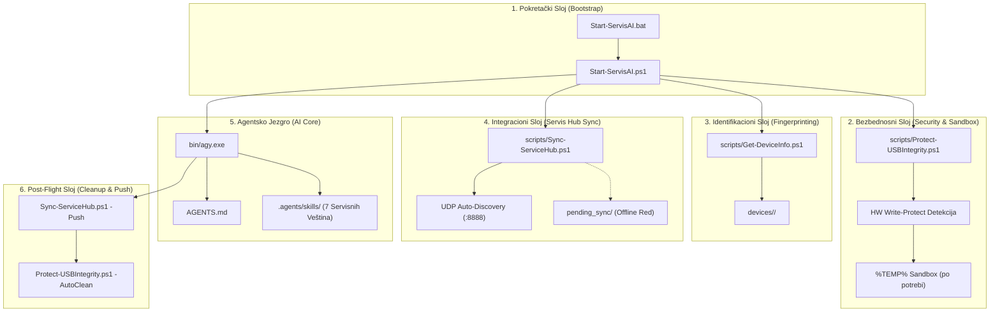
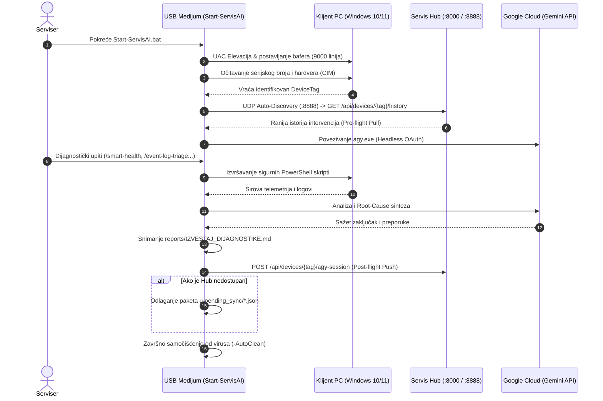

# Pregled Arhitekture Projekta: AGY Serviser Portable

Ovaj dokument definiše sveobuhvatnu arhitekturu, podsisteme, bezbednosni model i tokove podataka projekta **AGY Serviser Portable** (Antigravity CLI Portable).

---

## 🎯 1. Cilj i Svrha
**AGY Serviser Portable** je prenosivi (portable) USB dijagnostički alat namenjen računarskim serviserima za brzu, tačnu i bezbednu hardversku i softversku analizu operativnih sistema **Windows 10 i Windows 11**.

### Ključni inženjerski postulati:
1. **Nulta instalacija (Zero-Dependency):** Alat ne zahteva instalaciju pozadinskih okruženja (Python, Node.js) na klijentskoj mašini. Izvršno jezgro je samostalni Go binarni fajl `bin/agy.exe` sa nativnim PowerShell skriptama.
2. **Zero-Trust autorizacija:** Nalog i lozinka servisera nikada se ne unose u pregledač klijenta; koristi se Headless Remote OAuth preko telefona.
3. **Root-Cause analiza:** Fokus na utvrđivanje primarnog uzroka kvara umesto površnih reinstalacija.
4. **Centralna integracija sa radionicom (ADR-0003):** Dvosmerna telemetrijska sinhronizacija sa serverom **Servis Hub** uz podršku za rad bez mreže (offline queue).

---

## 🏗️ 2. Šestoslojni Arhitektonski Model

---

## 🔄 3. Tok Podataka (Data Flow)

---

## 📚 4. Povezane Beleške i Dokumentacija
- [[index]] — Glavni MOC navigacioni indeks
- [[decisions/ADR-0001-portable-usb-architecture]] — Arhitektura prenosivog USB CLI agenta
- [[decisions/ADR-0002-hardware-write-protect-and-device-fingerprint]] — Hardverska identifikacija i zaštita od upisa
- [[decisions/ADR-0003-servis-hub-bidirectional-sync]] — Dvosmerna integracija sa Servis Hub-om
- [[domain/glossary]] — Rečnik domena i tehnički pojmovnik
- [[memory/gotchas]] — Rešeni problemi, bagovi i inženjerski trikovi
- Glavna tehnička dokumentacija: `TEHNICKA_DOKUMENTACIJA.md`
- Servisno uputstvo za tehničare: `UPUTSTVO_ZA_KORISCENJE.md`
